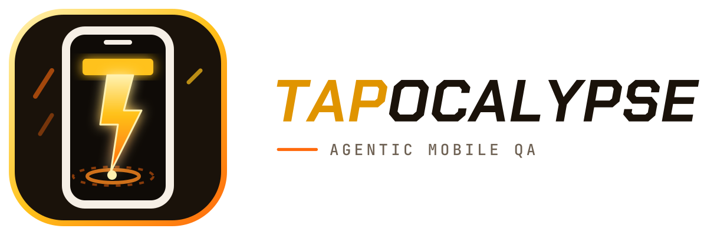
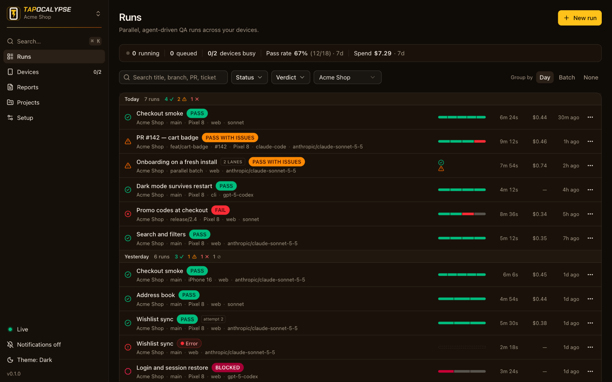
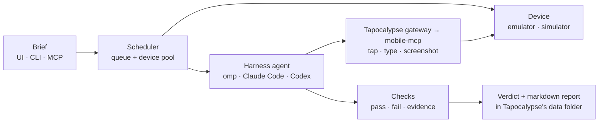
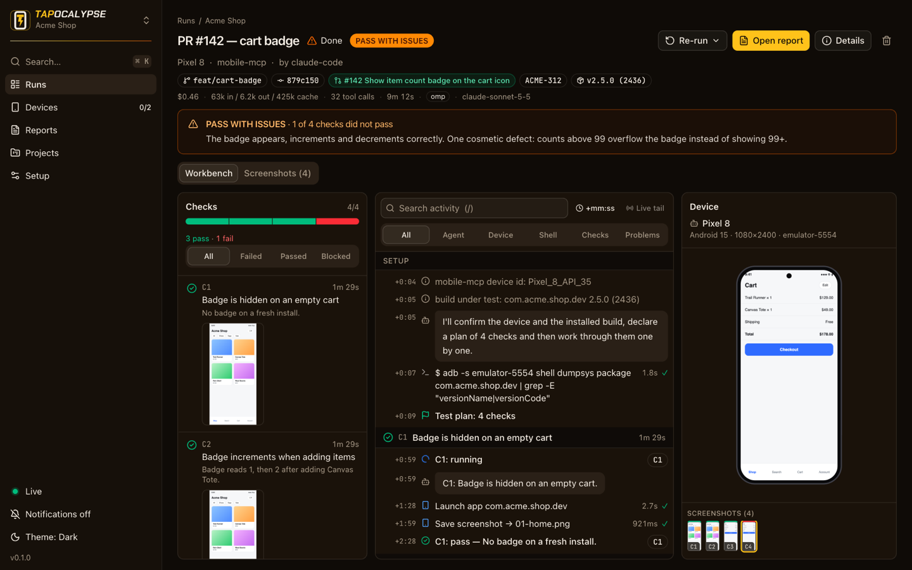
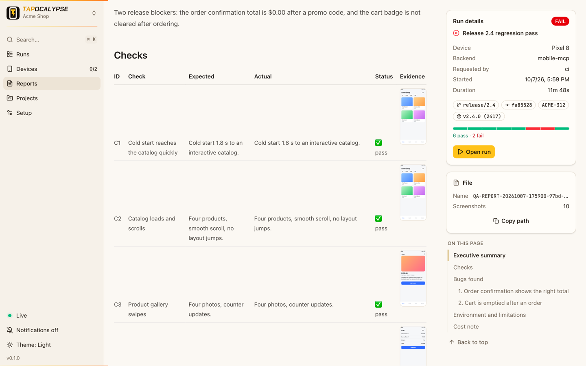
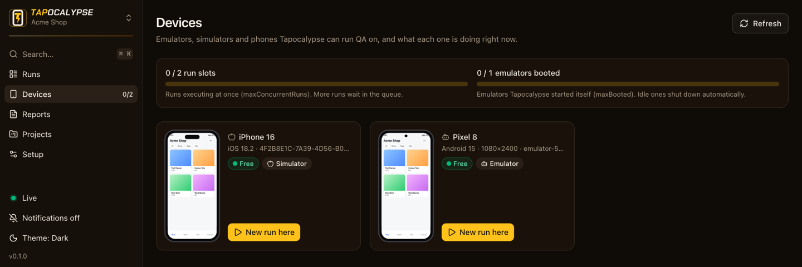
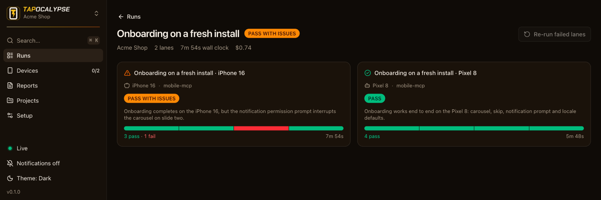
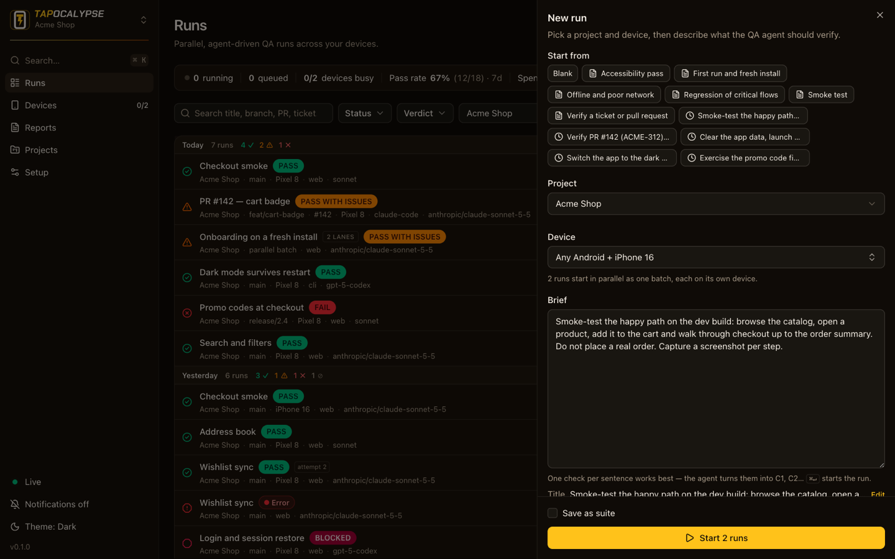

<h1 align="center"><picture><source media="(prefers-color-scheme: dark)" srcset="docs/images/logo-lockup-dark.svg"></picture></h1>

<p align="center"><strong>Agentic mobile QA.</strong> Write what to test in plain language. Watch AI agents tap through your app on emulators and simulators, in parallel. Get a verdict with evidence.</p>

<p align="center">
  
  
  
  
  
</p>

Tapocalypse is a local console for agent-driven mobile QA. You give it a brief ("open Settings, toggle dark mode, verify it survives a restart"). A headless coding agent drives your app on a real emulator or simulator, reports every check live, and writes a markdown report with screenshots that Tapocalypse keeps in its own data folder, never in your repo. The agent runs on the CLI you already use, [omp](https://github.com/can1357/oh-my-pi), [Claude Code](https://code.claude.com) or [Codex CLI](https://github.com/openai/codex), with whatever model or subscription it is signed in to. Start runs from the web UI, the command line, CI, or over [MCP](https://modelcontextprotocol.io) from the coding agent that just changed your code.

<picture>
  <source media="(prefers-color-scheme: light)" srcset="docs/images/runs-light.png">
  
</picture>

## What it is for

**The problem.** Mobile QA is slow and manual. Coding agents ship changes faster than anyone can click through the app, and nobody re-tests the whole thing after every pull request. Unit and widget tests do not notice that the button is hidden behind the keyboard.

**What Tapocalypse does.** It turns a plain-language brief into a QA run on a real Android emulator or iOS simulator. Several runs execute side by side, one per device. Every check comes back with a status, a note and a screenshot, and the run ends with a verdict and a report you can read, link and re-run.

**Who it is for.** Mobile teams that want a QA pass on every PR. Solo developers who ship with coding agents and want the agent to test its own work. CI on a machine you control. It works with any app you can install on a device: Flutter, React Native / Expo, native Android or iOS, Kotlin Multiplatform.

**What it is not.** Not a test framework: there are no scripts, selectors or recorded flows to maintain. Not a device farm: it uses the emulators, simulators and phones on your machine. It does not build your app: install it yourself, or hand Tapocalypse an `.apk`, `.app` or `.ipa`.

## How it works



1. **Brief.** Pick a project (your app's repo), write what to test and what counts as a failure, and pick a platform or a specific device.
2. **Device.** The scheduler assigns a free emulator or simulator, or boots one from your configured AVDs and simulators. If everything is busy, the run waits in a queue and says why.
3. **Agent.** A headless QA agent starts inside your repo (reading only: it is told never to write there) and drives the app through [mobile-mcp](https://github.com/mobile-next/mobile-mcp), served by Tapocalypse and pinned to the run's device: taps, typing, screenshots, `adb` and `simctl`.
4. **Checks.** The agent declares its checks up front and reports each one as it goes. You watch them turn pending → running → pass/fail next to a live device screen and the agent's activity feed. Cancel at any time; steer it on omp and Claude Code.
5. **Verdict.** The agent hands in a markdown report; with its screenshots it is stored in `<data dir>/runs/<run-id>/` (`report.md`, `screenshots/`), and the run ends with `PASS`, `PASS WITH ISSUES`, `FAIL`, `BLOCKED` or `PARTIAL`, plus a summary and what it cost. Read it in the UI, with `qa_get_report` / `qa_get_screenshots`, or `tapocalypse report <run-id>`; copy it anywhere with `qa_export` or `tapocalypse report <run-id> --export <dir>`.
6. **Share.** Any finished run becomes one self-contained HTML file for stakeholders (no Tapocalypse needed), or a presigned link to a private bucket once `share.s3` is configured: [sharing a report](docs/guide.md#sharing-a-report).

Details: [run outcomes](docs/guide.md#run-outcomes), [devices](docs/guide.md#devices) and [what happens under the hood](docs/guide.md#how-it-works).

## Highlights

<table>
  <tr>
    <td width="50%"><br><b>Run workbench.</b> Checks, the agent's tool timeline and the device screen, side by side.</td>
    <td width="50%"><br><b>Reports.</b> The agent's markdown report with an outline and a screenshot gallery.</td>
  </tr>
  <tr>
    <td width="50%"><br><b>Devices.</b> Live thumbnails, busy and idle state, boot and shut down on demand.</td>
    <td width="50%"><br><b>Batches.</b> One brief on up to 8 devices, one rolled-up verdict.</td>
  </tr>
  <tr>
    <td width="50%"><br><b>New run.</b> Templates, saved suites, harness, device and model in one sheet.</td>
    <td width="50%">⚡ <b>Built for the keyboard.</b> <code>⌘K</code> command palette, <code>n</code> for a new run, <code>j</code>/<code>k</code> through checks, <code>g r</code> / <code>g d</code> to jump. Light and dark themes, desktop notifications when a run finishes. <a href="docs/guide.md#tour-of-the-ui">Tour of the UI →</a></td>
  </tr>
</table>

## Quick start

You need:

- [ ] [Bun](https://bun.sh) ≥ 1.3
- [ ] **One** agent runtime, installed and signed in: [omp](https://github.com/can1357/oh-my-pi), [Claude Code](https://code.claude.com) or [Codex CLI](https://github.com/openai/codex) ([details](#runtimes))
- [ ] Node.js 18+ with `npx` (runs mobile-mcp, which Tapocalypse starts for each run)
- [ ] Android `adb` with an emulator, and/or Xcode with iOS simulators (macOS). Linux runs Android only; Windows is not supported
- [ ] Your app installed on that emulator or simulator

```sh
git clone https://github.com/miles-pudge-halter/tapocalypse.git
cd tapocalypse
bun install
bun run doctor     # fix anything marked ✗
bun start          # → tapocalypse listening on http://127.0.0.1:4310
# or keep it running in the background and start it at login (macOS, Linux):
bun src/cli.ts service install
```

`service install` keeps Tapocalypse running in the background and starts it at login, so your coding agent's MCP calls always find it; `service status|logs|stop|uninstall` manage it ([details](docs/guide.md#running-as-a-service)). On Windows, or if you prefer a foreground server, use `bun start`.

1. Open <http://127.0.0.1:4310>. The **Setup** page walks you through the rest and ticks itself off.
2. Start an emulator or simulator with your app installed, or list an AVD in `devicePool.android.avds` and let Tapocalypse boot it ([Devices](docs/guide.md#devices)).
3. **Projects → Add project**: pick a suggested folder or paste the absolute path of your app's repo. Detection fills in the name, package or bundle id, platform and persona. Check them and save.
4. **Runs → New run** (or press `n`): pick the project and a device, write a title and a brief, and start. You land on the run page with live checks, device screen and activity.

Everything else, from personas and suites to CI and troubleshooting, is in the [guide](docs/guide.md).

## Setup for agents

Let your coding agent do the setup. Paste this into omp, Claude Code, Codex, Cursor or any agent that can run shell commands, from inside your app's repo:

```text
Set up Tapocalypse for this repo: read https://raw.githubusercontent.com/miles-pudge-halter/tapocalypse/main/docs/agent-setup.md and follow it.
```

The agent follows [docs/agent-setup.md](docs/agent-setup.md). It checks the prerequisites and tells you exactly what is missing, clones and installs Tapocalypse, runs the doctor, installs and starts the server as a background service on port 4310, registers the MCP server in its own harness, detects your app and registers it as a project, confirms a device is ready, and runs one short smoke test. It finishes with the run URL and the verdict. The smoke run costs real tokens on your agent runtime: one short session.

**Connect an agent by hand.** The **Setup** page shows these snippets with a live "connected" indicator.

| Agent | Register `http://127.0.0.1:4310/mcp` |
| --- | --- |
| omp | Merge `{ "mcpServers": { "tapocalypse": { "type": "http", "url": "http://127.0.0.1:4310/mcp", "timeout": 120000 } } }` into `~/.omp/agent/mcp.json` |
| Claude Code | `claude mcp add --transport http --scope user tapocalypse http://127.0.0.1:4310/mcp` |
| Cursor | Merge `{ "mcpServers": { "tapocalypse": { "url": "http://127.0.0.1:4310/mcp" } } }` into `~/.cursor/mcp.json`, then reload Cursor |
| Codex CLI and others | Any streamable-HTTP MCP client works; allow tool calls of at least 120 s ([Codex snippet](docs/guide.md#dispatching-runs-from-your-coding-agent-mcp)) |

**Then just ask.** "Implement the dark-mode toggle, then use Tapocalypse to check on Android that it works and survives an app restart." The agent typically:

1. Calls `qa_list_projects` to find the project id (or `qa_detect_project` + `qa_create_project` the first time).
2. Calls `qa_start_run { projectId, title, brief, requester, source: { path: "<its cwd>" } }`, so the run records its branch, commit and PR.
3. Calls `qa_wait_run { runId }` until `timedOut` is `false`, narrating the checks as they resolve.
4. Reads the verdict and the report (`qa_get_report`, with the screenshots from `qa_get_screenshots`), fixes what failed, then confirms with `qa_rerun { runId, only: "failed" }`.
5. Calls `qa_find_regressions { projectId, branch }` to see whether anything that passed before now fails (see below).

The tools range from batches to steering to device leases: [MCP reference](docs/guide.md#dispatching-runs-from-your-coding-agent-mcp) and [parameters](docs/api.md#mcp-tools).

**Share devices between agents.** Tapocalypse is also the device broker for every coding agent on the machine. An agent borrows an emulator or simulator with `device_acquire` (a *lease*), uses only that one, and gives it back with `device_release`. While it is leased, no other agent and no QA run is given that device; they wait in one first-in, first-out queue, and a lease that is not renewed ends on its own (default 30 minutes). The Devices page shows who holds each device and why, and lets you release a stuck lease. Leases are cooperative: they keep well-behaved agents apart but do not stop a process that runs `adb` on its own. [Sharing devices between agents](docs/guide.md#sharing-devices-between-agents), and the snippet to give your agents is in [docs/agent-setup.md](docs/agent-setup.md#8-let-your-agents-borrow-devices-optional).

**Catch regressions.** Tapocalypse remembers every check of every run. Each check gets an identity across runs, and every run is compared with an automatic baseline (the same test on the PR's base branch, the default branch or the previous commit), so you see what is *newly failing*, *fixed*, *flaky* or no longer covered, check by check with screenshots side by side, plus a history for any single check. `qa_find_regressions` answers "did I break anything?" for the agent that just changed your code, `tapocalypse compare <run>` and `tapocalypse run … --fail-on regression` do it in CI (exit 1 only on checks that passed before and fail now, flaky ones excluded), and the UI shows it in a *Compared to* strip, a compare page and a flaky-checks page. History needs the same test to run repeatedly: see [Regressions, history and flaky checks](docs/guide.md#regressions-history-and-flaky-checks).

## Runtimes

Tapocalypse ships no model and no agent loop. It drives a coding-agent CLI headlessly. Install and sign in to at least one; pick per run, per project or in the config.

| | [omp](https://github.com/can1357/oh-my-pi) | [Claude Code](https://code.claude.com) | [Codex CLI](https://github.com/openai/codex) |
| --- | --- | --- | --- |
| Install | See the omp README | `npm install -g @anthropic-ai/claude-code` | `npm install -g @openai/codex` |
| Sign in | `omp login` or a provider API key | `claude auth login` | `codex login` |
| Steer a running agent | Yes | Yes | No |
| Cost | When the provider reports one | Yes (Claude Code's estimate) | Tokens only |
| Full transcript | Yes | No (activity feed) | No (activity feed) |

Selection order, limits and models: [Agent runtimes](docs/guide.md#agent-runtimes).

## Docs

- [Guide](docs/guide.md): the UI, projects and personas, devices, run outcomes, regressions and flaky checks, MCP, CLI and CI, suites, data, troubleshooting
- [Configuration](docs/configuration.md): every config key and environment variable
- [HTTP API and MCP tools](docs/api.md): every route and tool parameter
- [Agent setup](docs/agent-setup.md): step-by-step instructions for a coding agent
- [Security](SECURITY.md): the threat model and how to report a vulnerability ([security model](docs/guide.md#security-model))
- [Contributing](CONTRIBUTING.md) and the [changelog](CHANGELOG.md)

## Status

Early: version 0.1. Local only by design: the server binds `127.0.0.1` and has no login, and QA agents run shell commands as your user. Read the [security model](docs/guide.md#security-model) before you point it at anything. Bugs and ideas go to [GitHub issues](https://github.com/miles-pudge-halter/tapocalypse/issues); see [what's not here yet](docs/guide.md#whats-not-here-yet).

## License

MIT, see [LICENSE](LICENSE).
