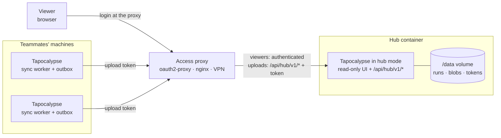
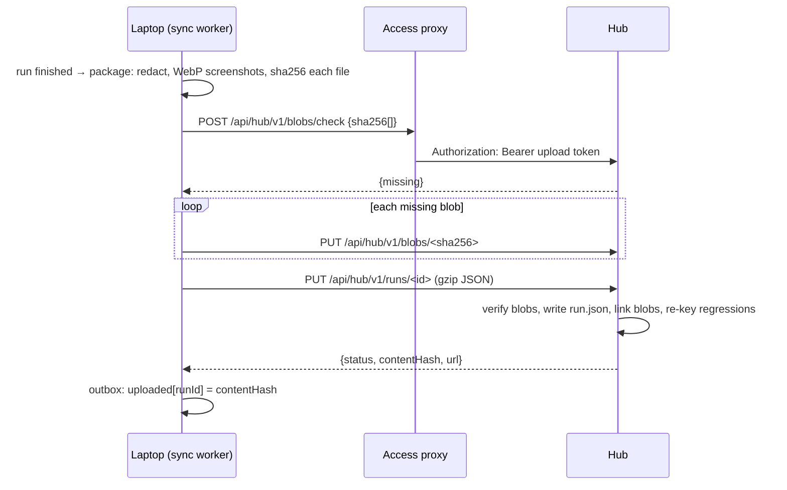

# Team hub

Back to the [README](../README.md). The **team hub** is the same Tapocalypse app started in a read-only *hub* mode. Teammates' machines push their finished runs to it, and teammates and stakeholders open it in a browser to see what was tested, with evidence, without installing anything and without being able to change anything.

Use it when more than one person runs QA and somebody else (a PM, a lead, a client) needs to answer "is release 2.4 good to go?" from one URL. For a single link to a single run, [Sharing a report](guide.md#sharing-a-report) is enough; [the comparison below](#report-links-or-a-hub) helps you choose.

## Contents

- [What the hub is](#what-the-hub-is)
- [Architecture](#architecture)
- [Deploy with Docker](#deploy-with-docker)
- [Put an access proxy in front](#put-an-access-proxy-in-front)
  - [Recipe A: nginx path split + oauth2-proxy (recommended)](#recipe-a-nginx-path-split--oauth2-proxy-recommended)
  - [Recipe B: oauth2-proxy alone with skip-auth routes](#recipe-b-oauth2-proxy-alone-with-skip-auth-routes)
  - [Recipe C: nginx `auth_request`](#recipe-c-nginx-auth_request)
  - [Recipe D: VPN only](#recipe-d-vpn-only)
  - [Verify the setup](#verify-the-setup)
  - [The identity header](#the-identity-header)
- [Upload tokens](#upload-tokens)
- [Connect a laptop](#connect-a-laptop)
  - [What is uploaded, and what never is](#what-is-uploaded-and-what-never-is)
  - [Projects that merge across machines](#projects-that-merge-across-machines)
  - [Live progress](#live-progress)
- [What stakeholders see](#what-stakeholders-see)
- [Retention](#retention)
- [Backups](#backups)
- [Upgrades and version skew](#upgrades-and-version-skew)
- [How big can a hub get](#how-big-can-a-hub-get)
- [Troubleshooting](#troubleshooting)
- [Reference](#reference)

## What the hub is

- **One container, the same code.** `TAPOCALYPSE_MODE=hub` (or `tapocalypse serve --hub`) starts the server with everything that touches devices, agents or repositories switched off: no device pool, no leases, no scheduler, no harness, no MCP endpoint. It keeps the run store, the regression index, reports, stats and the live event stream.
- **Read-only for viewers.** Every route a viewer can reach only reads. Starting, cancelling, re-running, deleting, exporting, creating projects and linking checks do not exist on a hub (the API answers `404 not available on the team hub`); the UI hides those controls instead of disabling them.
- **No accounts.** The hub has no login. *Who may view* is decided by an **access proxy** you run in front of it (oauth2-proxy, a VPN, any reverse proxy that authenticates). *Who may upload* is decided by a per-machine **upload token** that the hub checks itself, so a misconfigured proxy can expose data to read but never lets anybody write.
- **Laptops push, the hub never pulls.** A project opted in with *Share with team hub* uploads each run when it finishes, in the background. Offline machines queue and catch up. Deleting a run on a laptop does not delete it from the hub.
- **Regressions are recomputed across machines.** The hub re-derives check identity over everybody's runs, so "newly failing" means newly failing for the team, not just for one laptop ([details](#projects-that-merge-across-machines)).
- **Stakeholder pages.** A project **Overview** (pass-rate trend, latest result per test and platform, what changed) and **Releases** (one version or release branch across every machine). Both also exist on a laptop's own store.

### Report links or a hub

| | [Share a report](guide.md#sharing-a-report) | Team hub |
| --- | --- | --- |
| What you hand over | One run as one HTML file or an expiring link | Everything your team ran, browsable |
| Needs | Nothing (the file) or an S3-compatible bucket (links) | A container, an access proxy, a token per machine |
| History, trends, releases | No | Yes |
| Viewer sees other runs of the project | No | Yes |
| Lifetime | The link expires (at most 7 days) | Until [retention](#retention) removes it |

## Architecture



An upload is a small, resumable exchange. Nothing leaves a laptop before it is [redacted](#what-is-uploaded-and-what-never-is):



Files are content-addressed (`<data>/hub/blobs/<sha256>`) and hard-linked into each run's folder, so a screenshot that two runs share is stored once, a re-upload of an unchanged run writes nothing, and an interrupted upload resumes blob by blob.

## Deploy with Docker

The repository ships a `Dockerfile` (Bun, non-root `bun` user, hub mode by default, data in `/data`) and `compose.hub.yml`, which runs the hub behind an nginx path split and an oauth2-proxy login ([Recipe A](#recipe-a-nginx-path-split--oauth2-proxy-recommended)). **The hub's port is not published**: only the other containers of the compose network can reach it.

```sh
git clone https://github.com/miles-pudge-halter/tapocalypse.git
cd tapocalypse
cp .env.hub.example .env.hub        # git-ignored: your identity provider's client id and secret, a cookie secret
$EDITOR .env.hub
$EDITOR compose.hub.yml             # replace qa.example.com, idp.example.com and the email domain with yours
                                    # (nginx.hub.conf, next to it, needs no edits)
docker compose --env-file .env.hub -f compose.hub.yml up -d --build
docker compose -f compose.hub.yml ps                      # hub should become "healthy"
docker compose -f compose.hub.yml exec hub bun src/cli.ts hub token create alice-laptop
```

Read the comments at the top of `compose.hub.yml` first. The values to replace are the public hostname (`TAPOCALYPSE_HUB_HOSTS` and `OAUTH2_PROXY_REDIRECT_URL`), the identity provider's issuer URL and the allowed email domain. nginx listens on `127.0.0.1:4180` in plain HTTP: put your TLS terminator (a reverse proxy, load balancer or ingress) in front of it, send it the public hostname, and make it **overwrite** any `X-Forwarded-*` header a client sent instead of passing it on ([Verify the setup](#verify-the-setup) checks this). The image needs no `git`, `adb`, Xcode or agent CLIs.

What the container does:

| | |
| --- | --- |
| Command | `bun src/server.ts` (hub mode comes from `TAPOCALYPSE_MODE=hub` in the image; `docker compose exec hub bun src/cli.ts hub …` therefore runs the hub's admin commands) |
| Data | `/data` (a named volume): runs, blobs, tokens, hub project registry. Back this up |
| Port | `4310` inside the container (`expose`, not `ports`), reachable only through the proxy |
| Health | `GET /api/health` → `{ ok, mode: "hub", runs, version }`; Docker's `HEALTHCHECK` uses it (allowed for the `localhost` Host header) |
| Memory | The hub keeps run summaries in memory (about 17 MB per 1,000 runs); the compose file sets `mem_limit: 1g`. See [How big can a hub get](#how-big-can-a-hub-get) |

Required and optional settings, all environment variables (see [Reference](#reference) for the full list):

- `TAPOCALYPSE_HUB_HOSTS`: the public hostname(s) viewers and machines use, comma-separated. A request whose `Host` header is not on the list (entries are matched exactly, so add `qa.example.com:8443` if the proxy forwards a non-default port; `localhost:<port>` and `127.0.0.1:<port>` are always allowed for the health check) is refused with 403. This keeps the DNS-rebinding protection that the laptop app has. **Set it**; without it nothing but `localhost` works.
- `TAPOCALYPSE_HUB_IDENTITY_HEADER`: optional, see [The identity header](#the-identity-header).
- `TAPOCALYPSE_HUB_RETENTION_DAYS`: default `365`; see [Retention](#retention).

Without Docker, any Linux box with Bun ≥ 1.3.14 works: `TAPOCALYPSE_MODE=hub TAPOCALYPSE_HOST=0.0.0.0 TAPOCALYPSE_DATA_DIR=/srv/tapocalypse bun src/server.ts`, with the same variables, behind the same proxy. **Never bind a hub to a public interface without a proxy in front.**

## Put an access proxy in front

Whatever you choose, the contract with the hub is the same:

1. **Viewers** (everything except the upload routes) must be authenticated by the proxy, or sit behind a network that only your team can enter.
2. **Uploads**, the routes under `/api/hub/v1/`, must reach the hub **with the machine's upload token** (`Authorization: Bearer tpu_…`). The hub checks it itself, so the simplest set-up lets exactly these routes through the proxy without a login and relies on the token. (If your proxy can authenticate machines too, for example with a static header, you can keep uploads behind it as well and set `share.hub.headers` on each laptop; see [Connect a laptop](#connect-a-laptop).)
3. The hub is reachable **only** through the proxy. No `ports:` on the hub service.
4. **Split by path in the front proxy; do not rely on a login proxy's skip-auth rule.** A rule such as oauth2-proxy's `--skip-auth-route` is evaluated by the login proxy from request data a client can influence. oauth2-proxy before 7.15.2 trusted a client-supplied `X-Forwarded-Uri` for it, so `curl -H 'X-Forwarded-Uri: /api/hub/v1/info' https://qa.example.com/api/runs` read every viewer page without a login ([GHSA-7x63-xv5r-3p2x](https://github.com/oauth2-proxy/oauth2-proxy/security/advisories/GHSA-7x63-xv5r-3p2x), CVE-2026-40575), and a missing `--trusted-proxy-ip` made the guard of the first fix useless. With the split done in nginx (or any front proxy that routes by path), the login proxy has no skip rule at all, so there is nothing to bypass. Whatever you use, **the outermost proxy must overwrite `X-Forwarded-Uri`, `X-Forwarded-Host` and `X-Forwarded-Proto` with its own values**, and the login proxy must trust forwarded headers only from the address range that proxy comes from.

The upload routes are exactly these (nothing else under `/api/hub/v1/` has to be let through):

| Method and path | Used for |
| --- | --- |
| `GET /api/hub/v1/info` | Connection and token probe (`hub login`, Setup → Test) |
| `POST /api/hub/v1/blobs/check` | Which files does the hub still need |
| `PUT /api/hub/v1/blobs/<sha256>` | Upload one screenshot, report or activity file |
| `PUT /api/hub/v1/runs/<id>` | Upload (or update) a run |
| `PUT /api/hub/v1/runs/<id>/live` | Progress of a run still in progress (memory only, see [Live progress](#live-progress)) |
| `GET /api/hub/v1/runs/<id>/state` | `hub push --verify` after a restore |
| `DELETE /api/hub/v1/runs/<id>` | Remove a run the machine uploaded (`hub unpublish`) |

`GET /api/hub/v1/machines` and the other `GET` routes serve the UI and **stay behind the login**: the machines list names uploaders. `/api/hub/v1/info` answers anybody who reaches it with the hub's version, protocol, and run and project counts (the machine name only for a valid token).

The allowlist used in the recipes is one anchored regular expression on the path (it does not constrain the method; the hub itself only accepts the methods in the table):

```text
^/api/hub/v1/(info|blobs/check|blobs/[0-9a-f]{64}|runs/[A-Za-z0-9-]+(/state|/live)?)$
```

Keep it anchored and narrow. Do not widen it to `^/api/hub/v1/.*`: that would also let anonymous callers read `GET /api/hub/v1/machines`.

**Encoded paths are refused.** The hub answers `400 { "code": "ambiguous_path" }` to any request whose path, exactly as it arrived, contains `%2f`, `%2e` or `%5c` (any case) or a backslash. A proxy and the hub must never read one path two ways; the hub's own URLs never contain these. The query string is not checked. If you see this error, a proxy rule or a client is rewriting or encoding the path: send it as plain `/` and `.` characters.

### Recipe A: nginx path split + oauth2-proxy (recommended)

`compose.hub.yml` and `nginx.hub.conf` are this recipe. nginx is the only entry point. It sends the [upload routes](#put-an-access-proxy-in-front) straight to the hub (the hub checks the upload token) and everything else to [oauth2-proxy](https://oauth2-proxy.github.io/oauth2-proxy/), which logs viewers in with your identity provider (Google, Microsoft, GitHub, Keycloak, any OIDC) and forwards them to the hub. oauth2-proxy has **no skip-auth rule**, so no route of the hub can be skipped past the login.

```nginx
server {
  listen 80;
  client_max_body_size 32m;                 # the hub accepts bodies up to 32 MB
  client_header_timeout 15s;                # the hub has no idle timeout of its own: bound slow clients here
  client_body_timeout 60s;

  # Machines: no login, the hub checks the upload token. Quote the expression: nginx reads an unquoted "{" as the start of a block.
  location ~ "^/api/hub/v1/(info|blobs/check|blobs/[0-9a-f]{64}|runs/[A-Za-z0-9-]+(/state|/live)?)$" {
    proxy_pass http://hub:4310;
    proxy_set_header Host $http_host;
    proxy_set_header X-Forwarded-Email "";  # an empty value drops the header: a machine cannot claim to be a person
  }

  # Viewers: everything else goes through the login. Live updates (the app-wide feed and each run page's stream) are
  # server-sent events, so do not buffer them. The hub also sends X-Accel-Buffering: no on every stream.
  location ~ "^/api/(events|runs/[^/]+/events)$" {
    proxy_pass http://oauth2-proxy:4180;
    proxy_http_version 1.1;
    proxy_set_header Connection "";
    proxy_set_header Host $http_host;
    proxy_set_header X-Forwarded-Uri $request_uri;   # never the client's value
    proxy_buffering off;
    proxy_read_timeout 1h;
  }
  location / {
    proxy_pass http://oauth2-proxy:4180;
    proxy_set_header Host $http_host;
    proxy_set_header X-Forwarded-Proto https;
    proxy_set_header X-Forwarded-Uri $request_uri;   # never the client's value
    proxy_set_header X-Forwarded-Email "";           # oauth2-proxy sets the signed-in viewer itself
  }
}
```

and, in `compose.hub.yml`, the oauth2-proxy service:

```yaml
  oauth2-proxy:
    image: quay.io/oauth2-proxy/oauth2-proxy:v7.15.2   # 7.15.2 or newer (see below)
    expose: ["4180"]                                    # only nginx reaches it
    environment:
      OAUTH2_PROXY_HTTP_ADDRESS: 0.0.0.0:4180
      OAUTH2_PROXY_UPSTREAMS: http://hub:4310
      OAUTH2_PROXY_PROVIDER: oidc
      OAUTH2_PROXY_OIDC_ISSUER_URL: https://accounts.example.com
      OAUTH2_PROXY_CLIENT_ID: ${OIDC_CLIENT_ID}
      OAUTH2_PROXY_CLIENT_SECRET: ${OIDC_CLIENT_SECRET}
      OAUTH2_PROXY_COOKIE_SECRET: ${OAUTH2_COOKIE_SECRET}   # python3 -c 'import os,base64; print(base64.urlsafe_b64encode(os.urandom(32)).decode())'
      OAUTH2_PROXY_COOKIE_SECURE: "true"
      OAUTH2_PROXY_REDIRECT_URL: https://qa.example.com/oauth2/callback
      OAUTH2_PROXY_EMAIL_DOMAINS: example.com               # who may view
      OAUTH2_PROXY_REVERSE_PROXY: "true"                    # nginx (and the TLS terminator before it) carry the original host and scheme …
      OAUTH2_PROXY_TRUSTED_PROXY_IPS: 172.29.40.0/24        # … trust forwarded headers from the compose network only (the file pins that subnet)
      OAUTH2_PROXY_PASS_USER_HEADERS: "true"                # X-Forwarded-Email for TAPOCALYPSE_HUB_IDENTITY_HEADER
      OAUTH2_PROXY_PASS_HOST_HEADER: "true"
```

How the pieces connect:

- **Upload routes never see the login, and the login never sees an upload route.** nginx evaluates a matching regular-expression `location` before the prefix `location /`. The expression is anchored and narrow, so any other path, including `GET /api/hub/v1/machines` (it names uploaders), goes through oauth2-proxy.
- **Use oauth2-proxy 7.15.2 or newer, and set `OAUTH2_PROXY_TRUSTED_PROXY_IPS`.** `--reverse-proxy` combined with a skip-auth rule made older releases trust a client-supplied `X-Forwarded-Uri` (GHSA-7x63-xv5r-3p2x, CVE-2026-40575); without a trusted-proxy list every client counts as a trusted proxy. This recipe has no skip rule, and still pins the fixed release and the list. Keep the image updated.
- **Who may view:** `OAUTH2_PROXY_EMAIL_DOMAINS` (or `OAUTH2_PROXY_AUTHENTICATED_EMAILS_FILE`); everyone else gets the provider's login page or a 403. oauth2-proxy sends the viewer's address to the hub as `X-Forwarded-Email`, so `TAPOCALYPSE_HUB_IDENTITY_HEADER: X-Forwarded-Email` is useful here.
- **Uploads carry no identity.** nginx clears the identity headers on the upload routes, so a machine cannot forge one; the run shows the machine (token) name and no person. See [The identity header](#the-identity-header).
- **Timeouts.** The hub itself has no idle timeout (live updates are long-lived streams), so the proxy bounds slow and idle clients: `client_header_timeout`, `client_body_timeout`, `send_timeout` and `keepalive_timeout` in `nginx.hub.conf`, and a one-hour read timeout only on the two event streams (`/api/events`, `/api/runs/<id>/events`). Keep equivalents if you use another front proxy, and make sure it does not buffer those streams: a buffered run stream leaves the run page on its loading placeholder.

### Recipe B: oauth2-proxy alone with skip-auth routes

One container fewer, a weaker boundary: oauth2-proxy itself decides which paths skip the login (`--skip-auth-route`), from data a client can influence. Use it only with oauth2-proxy **7.15.2 or newer**, with `OAUTH2_PROXY_TRUSTED_PROXY_IPS` set, behind a TLS terminator that overwrites `X-Forwarded-Uri`, and run the [spoof check](#verify-the-setup). Recipe A is the one to prefer.

```yaml
services:
  hub:
    build: .
    restart: unless-stopped
    environment:
      TAPOCALYPSE_HUB_HOSTS: qa.example.com
      TAPOCALYPSE_HUB_IDENTITY_HEADER: X-Forwarded-Email
    volumes: [hub-data:/data]
    mem_limit: 1g
    # no "ports:": only the proxy can reach the hub

  oauth2-proxy:
    image: quay.io/oauth2-proxy/oauth2-proxy:v7.15.2   # 7.15.2 or newer (see below)
    restart: unless-stopped
    ports: ["127.0.0.1:4180:4180"]                      # TLS terminates in front of this (Caddy, a load balancer, …)
    environment:
      OAUTH2_PROXY_HTTP_ADDRESS: 0.0.0.0:4180
      OAUTH2_PROXY_UPSTREAMS: http://hub:4310
      OAUTH2_PROXY_PROVIDER: oidc
      OAUTH2_PROXY_OIDC_ISSUER_URL: https://accounts.example.com
      OAUTH2_PROXY_CLIENT_ID: ${OIDC_CLIENT_ID}
      OAUTH2_PROXY_CLIENT_SECRET: ${OIDC_CLIENT_SECRET}
      OAUTH2_PROXY_COOKIE_SECRET: ${OAUTH2_COOKIE_SECRET}
      OAUTH2_PROXY_COOKIE_SECURE: "true"
      OAUTH2_PROXY_REDIRECT_URL: https://qa.example.com/oauth2/callback
      OAUTH2_PROXY_EMAIL_DOMAINS: example.com               # who may view
      OAUTH2_PROXY_REVERSE_PROXY: "true"                    # TLS terminates in front of oauth2-proxy …
      OAUTH2_PROXY_TRUSTED_PROXY_IPS: 172.16.0.0/12         # … so trust ONLY that proxy's address (your Docker network). Never leave it unset
      # Machines: the upload routes skip the login and are protected by the upload token.
      # Comma-separated list, so the regex must not contain a comma.
      OAUTH2_PROXY_SKIP_AUTH_ROUTES: "^/api/hub/v1/(info|blobs/check|blobs/[0-9a-f]{64}|runs/[A-Za-z0-9-]+(/state|/live)?)$"
volumes: { hub-data: {} }
```

- **`/api/hub/v1/*` reaches the hub with the token.** `--skip-auth-route` (`OAUTH2_PROXY_SKIP_AUTH_ROUTES`) makes oauth2-proxy forward matching requests without a session; the laptop's `Authorization: Bearer tpu_…` header and the body arrive at the hub, which validates the token. Leave `--basic-auth-password`, `--pass-authorization-header` and `--pass-access-token` unset: oauth2-proxy strips (and replaces) the `Authorization` header on skipped routes when it would set one itself.
- **Use oauth2-proxy 7.15.2 or newer.** Up to 7.10 `skip_auth_routes` matched the path *plus* the query string, so a crafted URL such as `/other?x=/api/hub/v1/info` could skip the login (GHSA-7rh7-c77v-6434, CVE-2025-54576). From 7.5.0 up to 7.15.1 a client-supplied `X-Forwarded-Uri` was trusted when `--reverse-proxy` was on, and the first fix left every client trusted when `--trusted-proxy-ip` was not set (GHSA-7x63-xv5r-3p2x, CVE-2026-40575). Keep the proxy updated, the expression anchored and narrow, and the terminator in front of it overwriting `X-Forwarded-Uri`. Both bypasses are checked in [Verify the setup](#verify-the-setup).
- **Who may view:** `OAUTH2_PROXY_EMAIL_DOMAINS` (or `OAUTH2_PROXY_AUTHENTICATED_EMAILS_FILE`); everyone else gets the provider's login page or a 403. oauth2-proxy sends the viewer's address to the hub as `X-Forwarded-Email`, so `TAPOCALYPSE_HUB_IDENTITY_HEADER: X-Forwarded-Email` is useful here.
- **Uploads on skipped routes carry no identity.** With `skip_auth_strip_headers` (the default, `true`) oauth2-proxy removes `X-Forwarded-User`, `X-Forwarded-Email` and the other identity headers from requests on skipped routes, so a machine cannot forge one; the run shows the machine (token) name and no person. See [The identity header](#the-identity-header).

### Recipe C: nginx `auth_request`

Use this when you already run nginx and oauth2-proxy as a pure authenticator (it answers `/oauth2/auth` with 202 or 401), or any other service that implements the same contract. nginx decides per path: the upload routes go straight to the hub, everything else needs a valid session.

```nginx
server {
  listen 443 ssl;
  server_name qa.example.com;
  # ssl_certificate / ssl_certificate_key …

  client_max_body_size 32m;                # the hub accepts bodies up to 32 MB
  client_header_timeout 15s;               # the hub has no idle timeout of its own: bound slow clients here
  client_body_timeout 60s;

  # oauth2-proxy's own pages (sign in, callback, sign out)
  location /oauth2/ {
    proxy_pass http://oauth2-proxy:4180;
    proxy_set_header Host $host;
    proxy_set_header X-Real-IP $remote_addr;
    proxy_set_header X-Auth-Request-Redirect $request_uri;
  }
  location = /oauth2/auth {
    internal;
    proxy_pass http://oauth2-proxy:4180;
    proxy_set_header Host $host;
    proxy_set_header X-Real-IP $remote_addr;
    proxy_set_header X-Forwarded-Uri $request_uri;
    proxy_set_header Content-Length "";
    proxy_pass_request_body off;
  }

  # Machines: no login, the hub checks the upload token (Authorization is passed through unchanged).
  # Quote the expression: nginx reads an unquoted "{" as the start of a block.
  location ~ "^/api/hub/v1/(info|blobs/check|blobs/[0-9a-f]{64}|runs/[A-Za-z0-9-]+(/state|/live)?)$" {
    proxy_pass http://hub:4310;
    proxy_set_header Host $host;
    proxy_set_header X-Auth-Request-Email "";          # an empty value drops the header: never trust a client-supplied identity here
  }

  # Viewers: everything else needs a session. Live updates use server-sent events, so do not buffer.
  location / {
    auth_request /oauth2/auth;
    error_page 401 =403 /oauth2/sign_in;
    auth_request_set $auth_email $upstream_http_x_auth_request_email;
    proxy_pass http://hub:4310;
    proxy_set_header Host $host;
    proxy_set_header X-Auth-Request-Email $auth_email;  # overwrites anything the client sent
    proxy_buffering off;
    proxy_read_timeout 1h;
  }
}
```

Start oauth2-proxy (7.15.2 or newer) with `--reverse-proxy=true --set-xauthrequest=true` and `--trusted-proxy-ip` set to nginx's address (never leave it unset), and give it no skip-auth rule, so it answers `/oauth2/auth` with `X-Auth-Request-Email`, which nginx passes on. Set `TAPOCALYPSE_HUB_IDENTITY_HEADER=X-Auth-Request-Email` on the hub if you want the person shown. They are only known for requests that went through the login, so uploads, which skip it, show the machine name ([The identity header](#the-identity-header)). The hub service has no published port; `hub` and `oauth2-proxy` are names on the Docker network.

nginx evaluates a matching regular-expression `location` before the prefix `location /`, so the upload routes never reach `auth_request`. Any path that does not match the expression (including `GET /api/hub/v1/machines`) falls through to the login.

### Recipe D: VPN only

No login at all: the hub is reachable only on a private network (WireGuard, Tailscale, ZeroTier, a corporate VPN), and everyone on that network may view. Writes still need an upload token.

```yaml
services:
  hub:
    build: .
    restart: unless-stopped
    environment:
      TAPOCALYPSE_HUB_HOSTS: qa.internal.example
    volumes: [hub-data:/data]
    mem_limit: 1g
    ports:
      - "10.8.0.1:4310:4310"      # bind the VPN interface address only, never 0.0.0.0
volumes: { hub-data: {} }
```

- **Bind to the VPN address**, not to all interfaces, or the hub is on the LAN or the internet too. Check with `ss -ltn | grep 4310` that it is not on `0.0.0.0`.
- Terminate TLS on the VPN address (a reverse proxy such as Caddy, or your VPN's HTTPS feature such as Tailscale Serve) so tokens do not travel in clear text on the network. Laptops use the `https://` address.
- **Everyone on the VPN is a viewer.** If that is more people than should see QA runs, use Recipe A instead, or restrict the VPN's ACLs to the hub.
- **Never expose a VPN-only hub through a public tunnel**, for example Tailscale Funnel: it removes the network boundary that Recipe D relies on.
- Person names: if your VPN's HTTPS front end sets an identity header that clients cannot forge, such as Tailscale Serve's `Tailscale-User-Login`, set it as `TAPOCALYPSE_HUB_IDENTITY_HEADER`. Otherwise leave it unset.

### Verify the setup

Do all of these checks after you bring a hub up and after every proxy change. Use `HUB=https://qa.example.com`.

1. **Viewers need a login.** Open `$HUB` in a **private window** (no cookies). You must land on your login page (Recipes A to C; oauth2-proxy serves its own sign-in page with HTTP 403 and redirects to the provider when you click through) or fail to connect at all from outside the VPN (Recipe D). If you see the hub's UI without logging in, the proxy is not protecting it: stop and fix that before anything else.
2. **A logged-in viewer sees the hub.** Log in. The sidebar shows the *Team hub* badge and no *New run*, *Devices* or *Setup*.
3. **Writes without a token are refused.** Each of these must answer `401` (not `200`, `201`, `204` or a login redirect):

   ```sh
   curl -sS -o /dev/null -w '%{http_code}\n' -X PUT  "$HUB/api/hub/v1/runs/20260101-000000-0000-check" \
     -H 'Content-Type: application/json' -d '{}'
   curl -sS -o /dev/null -w '%{http_code}\n' -X POST "$HUB/api/hub/v1/blobs/check" \
     -H 'Content-Type: application/json' -d '{"sha256":[]}'
   curl -sS -o /dev/null -w '%{http_code}\n' -X DELETE "$HUB/api/hub/v1/runs/20260101-000000-0000-check"
   ```

   A `302` or `403` from the proxy means the upload routes are not let through: machines cannot upload ([Troubleshooting](#troubleshooting)). Viewer writes, for example `curl -X DELETE $HUB/api/runs/<id>` with a valid login session, answer 404 `not available on the team hub`.
4. **A machine with a token gets through.** From a laptop: `tapocalypse hub login $HUB`, `hub login` prints `Connected to <host> as <machine>`, and `tapocalypse hub status` shows `Connection: ok as <machine>`. `curl -s $HUB/api/hub/v1/info -H "Authorization: Bearer tpu_…"` returns `"machine": "<name>"`; without the header it returns `"machine": null`.

5. **Spoofed forwarding headers do not skip the login.** Anonymous requests that pretend to be an upload route must still be sent to the login (a `302` to your identity provider or a `401`/`403`), never answered with hub data. Each of these must **not** print a JSON run list or a `200`:

   ```sh
   curl -sS -i -H 'X-Forwarded-Uri: /api/hub/v1/info' "$HUB/api/runs" | head -n 1
   curl -sS -i -H 'X-Forwarded-Uri: /api/hub/v1/info' -H 'X-Original-URL: /api/hub/v1/info' "$HUB/api/projects" | head -n 1
   curl -sS -i "$HUB/api/runs?x=/api/hub/v1/info" | head -n 1
   ```

   This is the oauth2-proxy bypass GHSA-7x63-xv5r-3p2x (versions before 7.15.2, or `--reverse-proxy` without `--trusted-proxy-ip`). If the first command returns `200`, stop: upgrade oauth2-proxy, set its trusted proxy list, and make the TLS terminator in front of nginx overwrite `X-Forwarded-Uri` (nginx: `proxy_set_header X-Forwarded-Uri $request_uri;`).

Also check that `GET $HUB/api/hub/v1/machines` in a private window goes to the login (it lists uploaders), and that the hub's own port is not reachable from outside: `curl -m 3 http://<server-ip>:4310/api/health` must time out or be refused.

### The identity header

`TAPOCALYPSE_HUB_IDENTITY_HEADER` names a request header, such as `X-Forwarded-Email`, `X-Auth-Request-Email` or `Tailscale-User-Login`. When it is set, the hub stores that header's value on each run the request uploads, as the person who uploaded it, and shows it next to the machine name ("by Ann on ann-mbp"). An email address is shortened to its local part, with the whole value in a tooltip. Without it, the UI shows only the machine name from the token ("from ann-mbp").

**Only turn it on when the hub is reachable solely through the proxy.** Anybody who can reach the hub's port directly can send any header they like, and the hub trusts it. That is why the compose files publish no port. Two further consequences:

- The header is only meaningful when the **proxy itself authenticated that request** and overwrites the header. Uploads that skip authentication (Recipes A, B and C) carry whatever the machine sent, so the recipes clear the header on those routes (Recipe B relies on oauth2-proxy stripping it) and the hub records no person for them. A person is recorded when the upload request came through an authenticating front end, for example a VPN identity header or a proxy that also accepts machines with a static header.
- It is *attribution for display*, not access control. It decides nothing about who may view or upload.

## Upload tokens

An upload token identifies one machine. The hub stores only its SHA-256 digest (`<data>/hub/tokens.json`, owner-only) and compares it in constant time. The token format is `tpu_` plus 32 random bytes in base64url. It is shown **once**, when it is created.

```sh
# on a container
docker compose -f compose.hub.yml exec hub bun src/cli.ts hub token create alice-laptop
docker compose -f compose.hub.yml exec hub bun src/cli.ts hub token list
docker compose -f compose.hub.yml exec hub bun src/cli.ts hub token revoke alice-laptop
# without Docker, with the same data dir the hub uses
TAPOCALYPSE_MODE=hub TAPOCALYPSE_DATA_DIR=/srv/tapocalypse bun src/cli.ts hub token create alice-laptop
```

- **The name is the machine name** (1 to 64 characters: letters, digits, `.`, `_`, `-`). It is attached to every run the token uploads (`from alice-laptop`), so name tokens after the machine (`alice-laptop`), not the person who could leave. One token per machine; do not share one between machines.
- `hub token create <name> --admin` makes an **admin** token, which may also delete runs uploaded by any machine. An ordinary token may delete only runs it uploaded. Give admin tokens to nobody who does not need them.
- `hub token list` shows names, admin flag, creation and last-used times and revoked state, never tokens or digests. `create` prints the token alone on standard output (the explanation goes to standard error), so `TOKEN=$(… hub token create alice-laptop)` works.
- `hub token revoke <name>` stops the token immediately. Runs it uploaded stay. The laptop's queue pauses with "the hub rejected this machine's upload token" until a new token is saved there.
- **Rotating:** create a new token (a revoked name can be reused, an active name cannot), save it on the laptop (`tapocalypse hub login`), revoke the old one. Runs keep the name of the token that uploaded them.
- **A leaked token** lets someone upload runs under that machine's name and learn only what *What a token can do* below says (it reads no run content). Revoke it, then remove anything suspicious on the hub with `hub unpublish --machine <name>` (or one run: `hub unpublish <runId>`; `--project <id>` narrows it).
- **What a token can do.**
  - Upload runs under *any* hub key. A token is not scoped to a project, so a leaked or malicious token can add runs to every project and so move its regression baselines and pass rates until you unpublish them.
  - Create new hub projects, but at most **20 new hub keys per token per 24 hours** (uploads and live updates together); the 21st gets `429 too_many_projects`. The count is stored with the project, survives a restart, and removing a project (`hub project remove`) frees its slot.
  - Learn two small facts: whether a run id exists on the hub and which machine uploaded it (`GET /api/hub/v1/runs/<id>/state`, and the `403`/`404` of `DELETE`), and whether a file with a given SHA-256 is stored (`POST /api/hub/v1/blobs/check`). Both are rate-limited so they cannot be used to scan.
  - Delete the runs it uploaded (an admin token may delete any run).
- **What a token cannot do.**
  - Read run content, reports or screenshots. The upload routes answer a token only with the two facts above, `info` and the result of its own uploads.
  - Change a project once it exists: the first upload names it (`hub project rename` is admin-only), and the first upload's repository URL and subpath stay (a later upload only fills one that is still empty). It cannot change a default branch an admin pinned with `hub project set-default-branch`.
  - Delete another machine's runs, or use the `admin/*` routes (admin tokens only).
  - Put a run in the future. `startedAt` and `endedAt` must be ISO datetimes or `null` (otherwise `422 invalid_run`), and any uploader time (`createdAt`, `startedAt`, `endedAt`, a batch's `createdAt`) later than the hub's clock plus 5 minutes is replaced by the time the hub received the upload. Retention, ordering and the default branch therefore only ever see sane times; the skew itself is still recorded and shown in About this hub.
  - Make the hub work without limit. Each token is limited, per minute, to 120 run uploads, 600 file uploads, 240 live updates and 600 `meta` calls (`blobs/check`, `runs/<id>/state` and `DELETE runs/<id>`), each with `429` and `Retry-After`. Files are at most 16 MB each, and unreferenced files are removed after 7 days. The scheduled re-key of a project (see [Projects that merge across machines](#projects-that-merge-across-machines)) runs at most once every 5 minutes, however many uploads arrive.
- Treat a token like a password for the machine; give admin tokens to nobody who does not need them.
- Token usage (`last used`) is kept in `<data>/hub/token-usage.json`, not in `tokens.json`, so a `hub token revoke` can never be undone by the running hub.
- Tokens never appear in logs, in `GET` responses or in the UI.

## Connect a laptop

Per machine, once:

```sh
tapocalypse hub login https://qa.example.com      # asks for the upload token (or --token / TAPOCALYPSE_HUB_TOKEN); the running server tests and saves it
tapocalypse hub status                              # connection, upload queue, shared projects
```

`hub login` needs the Tapocalypse server running (`bun start` or `tapocalypse service start`): it hands the address and the token to that server, which saves them next to **its own** config (the address in the config, the token in `hub-credentials.json`, mode 600) and then tests the connection, so it works however the server was started (another `TAPOCALYPSE_CONFIG`, a background service). It prints where the server keeps the token and exits non-zero with the hub's reason when the connection test fails. The address must be `https://` (plain `http://` is accepted only for `localhost`). Add `--header "Name: value"` (repeatable) for an access proxy that wants a static header, and `--screenshots original` to keep PNGs. Or in the UI: **Setup → Connect to a team hub** (address and token, plus optional proxy headers), which does the same.

**Moving to a different hub.** The saved token and proxy headers belong to the hub they were entered for, so they never follow a changed address to another host. If the new address has a different origin (scheme, host or port) than the saved one, `hub login` and **Setup → Connect to a team hub** need the new hub's upload token in the same request (`400 token_required_for_new_hub` without it), and the saved proxy headers are dropped unless you send new ones; keeping a saved header value (`null` in the API) is refused across origins. A change inside one origin (another path, a trailing slash) keeps the token and headers as before, and so does the first connection. **With `TAPOCALYPSE_HUB_TOKEN` set in the environment, a move to a hub with a different origin through Setup or `hub login` is refused**, because the token that would travel is the environment's and the form cannot replace it: change `share.hub.url` in the config file and the environment variable (and `TAPOCALYPSE_HUB_HEADERS`, if you use it) yourself, then restart.

Where things are kept:

| What | Where |
| --- | --- |
| Hub address, screenshot mode, non-secret extra headers | `share.hub` in the [config file](configuration.md#team-hub-sharing) |
| Upload token and secret proxy headers | `hub-credentials.json` next to the config file, mode `600` (a file others can read is refused). `TAPOCALYPSE_HUB_TOKEN` and `TAPOCALYPSE_HUB_HEADERS` (a JSON object) in the environment override it |
| Upload queue and what was uploaded | `<data dir>/hub-outbox.json` |

Use the file, not shell exports, when Tapocalypse runs as a [service](guide.md#running-as-a-service): `tapocalypse service install` never writes `TAPOCALYPSE_HUB_TOKEN` or `TAPOCALYPSE_HUB_HEADERS` into the launchd or systemd unit (it warns on stderr that it skipped them, and the unit file is mode 0600), so the service finds the token only in `hub-credentials.json`. Agents never see these variables either: they are removed from every agent's environment.

Then opt projects in. A project shares **only** when you turn it on:

1. **Projects → edit a project → Share with team hub.** The form shows the *hub project key* these runs will merge under (see [below](#projects-that-merge-across-machines)) and offers to upload the runs you already have. Or in the config: `"share": true` on the project.
2. Finished runs upload by themselves, one at a time, oldest first. The run header shows a chip: *Queued*, *Uploading…*, *On team hub ↗*, *Upload failed · retrying in 4 min* or *Uploads paused*.
3. **Backfill** existing runs from the terminal when you prefer: `tapocalypse hub push --project <id> [--since <date>]` (or `--all`, `--failed`, or run ids; one selector is required). The running server uploads them in the background; `--wait` follows the queue until it is empty (exit code 1 if some failed or uploads are paused). `--dry-run` works on this machine alone: it prints how many runs, files and bytes would be sent and how many secrets were masked, and sends nothing. `--verify` asks the hub what it has instead of trusting the local record (use it after restoring a hub from a backup).
4. **Inspect what would be sent** for one run before you trust it: `tapocalypse hub pack <runId> --out <dir>` writes `upload.json` (the exact run document) and `blobs/` (the report, the activity feed and the WebP screenshots) to `<dir>` without contacting the hub, and prints sizes and how much was redacted.
5. **Remove a run from the hub:** `tapocalypse hub unpublish <runId>` (or *Remove from team hub* on the run page), or `hub unpublish --project <id>` for all of a project's runs. Turning sharing off only stops future uploads.

When the machine is offline the queue grows and nothing is lost; uploads retry with back-off (30 seconds doubling up to 1 hour). Some states pause the whole queue: **401** (token rejected or revoked), a proxy login page instead of the hub, unusable credentials, and **426** (the hub needs a newer Tapocalypse). The queue resumes on its own, checking every 30 seconds, once the token, address or headers change or Tapocalypse is updated. A run whose id another machine already uploaded (`409 id_conflict`, about 1 in 65,536 even for the same second and title) is parked, never overwritten.

If your proxy lets machines through with static headers (for example a service token's client id and secret), add them as `headers` in `hub-credentials.json` (or `TAPOCALYPSE_HUB_HEADERS`); they are sent on every hub request next to the upload token. Keep secret values out of the config file: `share.hub.headers` there is for values that are not secret.

### What is uploaded, and what never is

**Uploaded**, for each finished run of a shared project:

- the run document (title, status, verdict, checks with notes, source (branch, commit, PR, tickets), build, device name, usage including **cost and model**, regression keys the machine computed);
- the **activity feed** the run page already shows (the mapped tool calls and messages, arguments truncated), not the raw event stream;
- the **report** and the **briefs and notes as written**: email addresses and test accounts are *not* removed, because they are needed to reproduce a bug;
- **screenshots**, re-encoded to WebP quality 80 (about 10× smaller). `share.hub.screenshots: "original"` keeps the PNGs.

**Never uploaded:**

- the raw `events.jsonl` (hundreds of megabytes of base64 images and the occasional access token);
- the transcript (`transcript.html`), the agent session, `stderr.log`;
- `tpc-mcp.json` / `mcp.json` (the run's progress token), the plugin folder, the persona file;
- device serials and UDIDs (`deviceSerial`, `deviceLabel`, the requested serial): the fields are left out, and the same ids, as a whole word, become `<device>` wherever they appear in text; the install path is reduced to its file name.

**Redacted before upload** (counted per kind in `hub push --dry-run` and in the upload itself):

- **Paths:** your home folder becomes `~`, other people's (`/Users/<name>`, `/home/<name>`) `~other`; the project's repo, the run's source folder and any git worktree become `<repo>`; Tapocalypse's data folder becomes `<data>`; temp folders become `<tmp>`.
- **Your account name:** command output such as `ls -l` or `lsof` prints it; as a whole word it becomes `<user>`. Email addresses keep it, and generic accounts (`root`, `runner`, `ubuntu`, …) and names shorter than 3 characters are left alone.
- **Devices:** the run's device serial, the serial that was requested, and the AVD name or simulator UDID become `<device>` as whole words (ids shorter than 4 characters are left alone, so ordinary words are not mangled).
- **Secret shapes**, which become `«redacted:<kind>»`:
  - Tokens and keys: `Bearer …` tokens, JWTs, `sk-…`, `sk-ant-…`, Stripe, `ghp_…` and other GitHub tokens, GitLab, npm and Hugging Face tokens, `AKIA…` AWS keys, `AIza…` Google keys, Slack `xox…` tokens, and private-key blocks (PGP included).
  - Headers: the whole value of an `Authorization` header, whatever its scheme (the header name stays), and of `Cookie` and `Set-Cookie` headers.
  - Command lines: `--password`, `--passwd`, `--token`, `--secret`, `--api-key` and `--apikey` (also with a prefix such as `--db-password`), followed by `=` or a space and a value; `curl -u user:pass` (the user stays, the password goes; any `-u a:b` is treated alike, so `docker -u 1000:1000` is masked too); credentials in a URL, including an empty user (`redis://:pw@host`).
  - Named values: `name=value`, `name: value` and JSON fields (also inside a JSON-encoded command string, with escaped quotes, however deeply encoded) whose name ends in a secret word: `token`, `secret`, `password`, `passwd`, `authorization`, `api_key`, `cookie`, `session`, `session_id`, `sid`, `credentials`, in snake_case, kebab-case, `camelCase` or `UPPER_CASE` (`accessToken`, `refreshToken`, `idToken`, `clientSecret`, `secretAccessKey`, `apiKey`, `AccountKey`, `SharedAccessKey`, `DB_PASSWORD`). The name must *end* in the word, so counters such as `maxTokens`, `inputTokens`, `tokenCount` and `tokensIn` stay. Because `session` and `authorization` count, a prose line such as `session: login flow` also loses its value.
- **Share links and downloads use the same redactor.** A [shared single-file report](guide.md#sharing-a-report) (Copy share link, Download HTML report, `tapocalypse share`, `report --html`, `qa_share_report`) rewrites its title, summary, facts, check titles and notes, report text and screenshot names exactly like a hub upload, with the same paths, `<user>`, `<device>` and secret masks.

Pattern redaction is a backstop, not a guarantee: an agent could write a secret in a shape that is not on the list into a check note or the report (not covered today: `--proxy-user`, cookies passed with `-b` unless their name is a secret word, `Digest` headers with quoted values, which are only partly masked, and non-string JSON values for secret fields), and a secret that is visible in a screenshot is not looked for. Look at `hub pack` output for a run you are unsure about, and keep the hub's viewers to people who may see your QA evidence.

### Projects that merge across machines

Two teammates call the same app `app` and `acme-shop`. The hub merges them by a **hub key**: the lowercase git remote without scheme or credentials plus a monorepo subfolder, such as `github.com/acme/shop` or `github.com/acme/shop#apps/mobile`. It is derived from `git remote get-url origin` and `git rev-parse --show-prefix`.

- A repository with **no git remote** cannot share until you give an explicit `hubKey` (the form suggests `local/<project id>`; such runs do not merge with a teammate's).
- Two projects on one machine that derive the same key (one repo, two apps) need an explicit `hubKey` on the second, for example `github.com/acme/shop#com.acme.kiosk`.
- The hub gives each key a project id (a slug of the last path segment) that never changes. **The first upload names the project** and no later upload from any machine renames it, so a backfill from another laptop cannot flip it; admins change it with `hub project rename <hubKey> "<name>"` (`hub project list` shows the ids and keys).
- **The first writer also keeps the repository URL and subpath.** A later upload only fills one of them that is still empty; it never replaces it.
- **The default branch** (used for baselines) follows the same stability rule: an explicitly set default branch beats one a laptop merely detected, and between equals the machine with the newest run decides, so backfilling an old run never changes it. An admin can pin it: `hub project set-default-branch <hubKey> <branch>` sets the branch and locks it, so no upload changes it until `hub project set-default-branch <hubKey> --clear` removes the branch and the lock and detection resumes.
- **Removing a project.** `hub project remove <hubKey>` forgets a project that has no runs, stored or live; otherwise it fails with `409 project_not_empty` and names `hub unpublish --project <id>`, which removes the runs first. A later upload of the same key creates the project again, and counts against that token's 20 new keys per 24 hours.
- **Admin commands** run on the hub, with its data directory: `hub token create|list|revoke`, `hub project list|rename|remove|set-default-branch`, `hub rekey` and `hub unpublish`. They work on the files directly, or, when the hub is running, through `POST /api/hub/v1/admin/*` with a temporary admin token the command creates and removes itself, so the running hub's memory never goes stale.

Regression identity is **recomputed on the hub** across everybody's runs: a machine's own check keys travel with the run but are only used to translate its manual links and `was` hints. Backfilled runs that are older than ones already on the hub trigger a debounced re-key of the project (oldest first), at most one pass per project every 5 minutes: a change that arrives sooner waits, and one trailing pass then covers all of them. After an upgrade that changes the key rules, force it with `hub rekey [--project <id>]` (it runs at once, whatever the 5-minute spacing). Laptops keep their own local keys; compare and history on a laptop stay "my runs".

### Live progress

While a run of a shared project is still going on a laptop, the hub shows it to viewers: the run appears in the run lists and on the project overview's **Running now** list, and its page reads **Live from `<machine>`** with the checks ticking over as the agent reports them (status, notes, pass/fail counts), then the verdict when the run ends.

- **What is never sent live:** the device screen, the activity feed, screenshots and the report. The run page says so ("The screen, activity and screenshots arrive when the run finishes."); the finished upload brings all of it, exactly as before. The run document sent live goes through the same field selection and redaction as the finished upload.
- **Memory only.** The hub keeps live runs in memory, never in the run store, so they do not touch stats, the overview, releases, regression history, machines, project run counts or retention, and a hub restart forgets them (the laptop's next change or heartbeat, at most a minute later, brings them back). When the finished run arrives it replaces the live one without a reload.
- **Stale and expired.** A laptop sends on every change (at most one request per 3 seconds per run) and a heartbeat every minute. After **3 minutes** without an update the run page shows an amber *No update from `<machine>` for N min* (the laptop is asleep or offline); after **30 minutes** the hub drops the run. A run that was cancelled or whose laptop never came back therefore disappears on its own; the finished upload, if it ever happens, still arrives.
- **Access:** live updates use the machine's upload token like any upload, with their own rate limit (240 a minute per token, apart from the run and file limits). The proxy must let machines through on `/api/hub/v1/runs/<id>/live`: the allowlist expression in [Put an access proxy in front](#put-an-access-proxy-in-front) and every recipe already contain it (a proxy set up before live progress needs `|/live` added after `/state`). **A live failure never stops uploads:** when a live update is refused (a hub without the route answers 404, a proxy that does not let `/live` through answers with its login page, or 401 or 426), the laptop stops sending live progress until its hub settings or token change, and keeps uploading finished runs. A run whose live document is too large (`413`) is not sent live; the brief is shortened to 4,000 characters and each note to 2,000 in live updates only.
- **Limits:** at most 32 runs live per machine and 512 per hub at once. A new run past that is refused (`429 too_many_live_runs`) and simply appears when it finishes; runs already live keep updating.
- **Turn it off on a laptop:** set `share.hub.live: false` in the [config file](configuration.md#team-hub-sharing). Finished runs still upload; nothing is sent while a run is going. Live progress is also never sent for a project that does not share.

## What stakeholders see

- **Home / Projects:** a card per project with the latest verdict, pass-rate trend and last upload.
- **Overview:** pass-rate trend, latest result per test and platform with history dots, newly failing and flaky counts, a branch or version selector, and "what changed since the last release".
- **Releases:** a **release** is a run version (`build.version`) or a branch named `release/*`, `releases/*`, `hotfix/*` or `release-*`. The view shows one release across every machine as a matrix of tests by devices, blockers first, rounds and re-runs folded, with changes against the previous release. **BLOCKED counts as a blocker** ("could not be tested"). A version and a branch of the same release appear separately.
- **Runs, reports, batches, compare:** the normal pages without any control that writes, plus who uploaded each run, from which machine, and cost and model.
- **About this hub:** version, protocol, run and project counts, retention, machines with their last upload and clock-skew warnings, and the three steps to connect a machine.

## Retention

The hub keeps runs for **365 days** after they ended (`TAPOCALYPSE_HUB_RETENTION_DAYS`, default `365`). `0` keeps everything. `TAPOCALYPSE_HUB_RETENTION_MAX_RUNS` additionally keeps only the newest N runs. The hub evaluates it at startup and every 6 hours and removes whole run folders (report, screenshots, activity). The laptop's own [retention](configuration.md#keys) is separate and never propagates: deleting or expiring a run on a laptop does not touch the hub, so team history is not wiped silently. Orphaned blobs (not linked from any run) are removed 7 days after they were last used. A run that ended before the cutoff is removed at the next sweep even if it was just uploaded, so a backfill should not send such runs (`/api/hub/v1/info` reports `retentionDays`; `hub push --since <date>` narrows a backfill).

## Backups

Everything is plain files under the data volume, and `run.json` is the source of truth. Back up `/data` (the `hub-data` volume):

- **A volume snapshot** (your cloud or filesystem snapshot) is the simplest.
- **`rsync`:** `rsync -aH --delete /var/lib/docker/volumes/<project>_hub-data/_data/ backup-host:/backups/tapocalypse-hub/`. **Keep `-H`:** blobs are hard-linked into the run folders, and without it the copy stores every shared screenshot twice.
- **`restic` or similar** work on the same directory; stop the hub or use a snapshot for a perfectly consistent copy. Run documents are written atomically and blobs are written before the run that references them, so a copy taken while the hub is running restores to a usable state.

`tokens.json` is in the volume, so a restore brings the tokens back (they are secrets: protect the backup as you protect the hub).

**Restore:** stop the hub, put the files back under `/data` (as the container's `bun` user), start it. Runs that machines uploaded after the backup are missing: on each laptop run `tapocalypse hub push --verify`, which asks the hub what it holds and uploads only the difference.

## Upgrades and version skew

- **Upgrade the hub:** `git pull && docker compose -f compose.hub.yml up -d --build`. `compose.hub.yml` and the `Dockerfile` pin their images by digest (the tag stays for reading), so an upgrade of nginx or oauth2-proxy is a change to that file, which Dependabot proposes. Data is additive and old `run.json` files keep loading. After an upgrade that changes how check keys are derived (the release notes say so), run `hub rekey`.
- **Laptops and the hub may differ in version.** The upload protocol is versioned (`/api/hub/v1/`, `protocol` in every body). The hub answers `426 { "code": "protocol_unsupported", "minProtocol" }` when a laptop is too old; the laptop then **pauses its queue** (banner in Setup, a warning in `tapocalypse doctor`) with "update Tapocalypse on this machine" and resumes after you update and press *Test again* or run `tapocalypse hub status`.
- A **newer laptop** can upload to an older hub: fields the hub does not know are dropped (the hub stores a whitelist of run, check, source and build fields), so nothing breaks, but a field added by a newer version only appears once the hub is updated and the run uploaded again.
- Update laptops first when you raise the hub's minimum protocol on purpose; otherwise order does not matter.
- **Clock skew:** if a laptop's clock differs from the hub's by more than 5 minutes, the hub records it and lists the machine in About this hub. Ordering of the machine's runs still follows its own timestamps, with one limit: a run time more than 5 minutes ahead of the hub's clock is replaced by the time the hub received the upload (so a laptop whose clock runs fast cannot place runs in the future, where retention and the default-branch rule would trust them).

## How big can a hub get

The hub uses the same in-memory run index as a laptop. At about **10,000 runs** (roughly a year for a team of ten running 3 to 5 runs per person per working day) store start-up takes seconds and heap is about 170 MB; at 50,000 runs about 840 MB of heap and 2.4 GB of resident memory. The hub doctor and `/api/hub/v1/info` warn from **8,000 runs** (`storeWarning`, shown in About this hub). Disk is mostly screenshots: about 1.2 MB per run with screenshots as WebP (about 12 MB as PNG originals). The planned fix is a SQLite summary store, not a bigger heap.

## Troubleshooting

Start with `docker compose -f compose.hub.yml logs hub` and the hub doctor (`docker compose -f compose.hub.yml exec hub bun src/cli.ts doctor`: data directory writable, free disk, run count against the 8,000-run warning, active tokens, `TAPOCALYPSE_HUB_HOSTS`, last upload per machine). On a laptop `bun run doctor` and `tapocalypse hub status` list reachability, the token, the protocol and the queue.

| Symptom | Cause and fix |
| --- | --- |
| Viewers see the hub **without logging in** | The proxy does not protect it, or the hub port is published. Fix the proxy, remove `ports:` from the hub service, then redo [Verify the setup](#verify-the-setup) |
| Browser: **403** `host not allowed` | The `Host` is not in `TAPOCALYPSE_HUB_HOSTS`, or the proxy rewrites `Host`. List the public hostname and pass `Host $host` (nginx) |
| `hub login` / Setup says **"The access proxy asked for a login"** (`proxy_login`) | The proxy answered the upload with a redirect or HTML. Let the [upload routes](#put-an-access-proxy-in-front) skip the login, or add the proxy's static header under `share.hub.headers` |
| **"The hub rejected the upload token"** (`unauthorized`, 401) | The token is wrong, truncated, revoked or belongs to another hub. `hub token list` on the hub; create a new token and save it with `hub login`. Queue pauses until then |
| **"This address is not a Tapocalypse hub"** (`not_a_hub`) | The address answers but not like a hub (a proxy error page, the wrong service, a laptop's own address). Use the hub's public address |
| **"Could not reach the hub"** (`unreachable`) | DNS, firewall or VPN is down. Uploads retry on their own; nothing is lost |
| **"This machine is too old for the hub"** (`protocol_unsupported`, 426) | Update Tapocalypse on the laptop; see [Upgrades](#upgrades-and-version-skew) |
| Run chip says **"Not uploaded: id taken on hub"** (`id_conflict`, 409) | Another machine already uploaded a run with this id. The run stays local; nothing on the hub was overwritten. Re-run it to get a new id |
| Upload fails with **413** / `too_large` | A file or run document is over the hub's limits (blob 16 MB, run document 2 MB), or the proxy's body limit is lower (nginx: `client_max_body_size 32m`). Raise `TAPOCALYPSE_HUB_MAX_BLOB_MB` and the proxy limit together |
| Runs are on the hub but a **teammate's regressions look wrong** | Check keys are recomputed on the hub. After a backfill, wait for the debounced re-key (about 30 s, and at most one pass per project every 5 minutes), or run `hub rekey --project <id>`, which runs at once |
| A project's runs **do not merge** across machines | Different hub keys. Compare `tapocalypse hub status` on both machines; set the same `hubKey` on the project, or fix the git remote |
| Nothing uploads and the queue is empty | The project is not shared, or the run is not finished. Check the project's *Share with team hub*, then `tapocalypse hub push --dry-run` |
| After restoring a backup some runs are missing | Run `tapocalypse hub push --verify` on each laptop |
| Requests fail with **500** `hub_state_corrupt` ("tokens.json is corrupt") | A hub state file (`tokens.json`, `projects.json`) no longer parses. The hub refuses to run on it instead of treating it as empty and overwriting it; a copy is kept next to it as `*.corrupt`. Restore it from a [backup](#backups) or repair the JSON, and the hub picks it up without a restart |
| Upload fails with **429** `rate_limited` | A token exceeded its per-minute budget: 120 run uploads, 600 file uploads, 240 live updates or 600 `meta` calls (`blobs/check`, `runs/<id>/state`, `DELETE runs/<id>`). `Retry-After` says when to try again; the laptop backs off and retries on its own |
| Upload fails with **429** `too_many_projects` | This token introduced more than 20 new hub keys in 24 hours (uploads and live updates together), usually a backfill of many projects at once, or hub keys that keep changing. Wait, or ask an admin to remove projects that should not exist (`hub project remove <hubKey>` frees a slot). Check `hub status` for the keys this machine shares |
| Live progress is refused with **429** `too_many_live_runs` | 32 runs of one machine or 512 of the whole hub are live already. Nothing is lost: the run appears when it finishes, and runs already live keep updating |
| `hub login` / Setup fails with **400** `token_required_for_new_hub` | The new address has a different origin than the saved one, so the saved token and proxy headers are not carried over. Enter the new hub's token (and proxy headers) in the same request. If `TAPOCALYPSE_HUB_TOKEN` is set in the environment, the form cannot replace it: change `share.hub.url` in the config file and the environment variable, then restart |
| `hub project remove` fails with **409** `project_not_empty` | The project still has stored or live runs. Remove them first with `hub unpublish --project <id>` (live runs disappear after 30 minutes of silence), then try again |
| A request fails with **400** `ambiguous_path` | The path contains `%2f`, `%2e`, `%5c` or a backslash. Something between the client and the hub is encoding or rewriting the path; send plain `/` and `.`, or fix the proxy rule |
| Hub container is `unhealthy` | `docker compose logs hub`. Usual causes: the volume is not writable by the `bun` user (UID 1000), or no free disk |
| **Hub memory keeps growing** | Look at the run count in About this hub; at 8,000 runs plan for the SQLite store and raise `mem_limit`. Lower `TAPOCALYPSE_HUB_RETENTION_DAYS` meanwhile |

## Reference

Hub environment variables (all start with `TAPOCALYPSE_`, so `tapocalypse service` on a plain Linux box passes them through too):

| Variable | Meaning |
| --- | --- |
| `TAPOCALYPSE_MODE` | `hub` starts hub mode (the image sets it). `tapocalypse serve --hub` is the same |
| `TAPOCALYPSE_HOST` | Bind address (the image sets `0.0.0.0`; the hub's port is not published) |
| `TAPOCALYPSE_PORT` | Port, default `4310` |
| `TAPOCALYPSE_DATA_DIR` | Data directory (the image uses `/data`) |
| `TAPOCALYPSE_HUB_HOSTS` | Comma-separated public hostnames that may reach the hub; `localhost` and `127.0.0.1` always may (health check) |
| `TAPOCALYPSE_HUB_IDENTITY_HEADER` | Request header to read as the uploader's identity, see [The identity header](#the-identity-header) |
| `TAPOCALYPSE_HUB_RETENTION_DAYS` | Remove runs that ended more than this many days ago; default `365`, `0` keeps everything |
| `TAPOCALYPSE_HUB_RETENTION_MAX_RUNS` | Keep only the newest N runs |
| `TAPOCALYPSE_HUB_MAX_BLOB_MB` | Largest accepted file, default `16` |

Laptop environment variables: `TAPOCALYPSE_HUB_TOKEN` (upload token; wins over the credentials file). While it is set, `hub login` and Setup refuse a move to a hub with a different origin ([Connect a laptop](#connect-a-laptop)). It is never copied into a service unit and never reaches an agent.

Routes and wire shapes: [HTTP API](api.md#team-hub). Laptop settings: [Configuration](configuration.md#team-hub-sharing).
